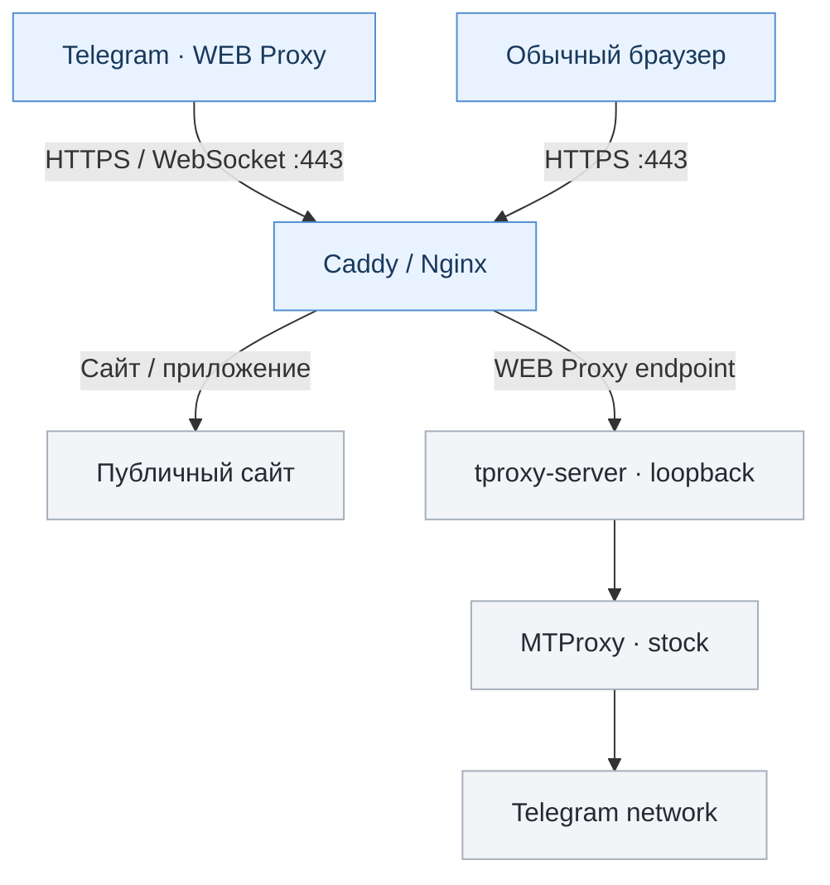

# TWebProxy Manager

Менеджер Telegram WEB Proxy для Debian и Ubuntu. Работает с [tproxy-server](https://github.com/telegramdesktop/tproxy-server), [MTProxy](https://github.com/TelegramMessenger/MTProxy), Caddy/Nginx, systemd и nftables.

**В `main` — v0.2.22-beta (только для тестирования).** Исправления безопасности v0.2.24 и разработка Bridge/Gate 3, включая тестовую v0.2.25-beta, пока не опубликованы в этой ветке. `main` не является подтверждённым RC или production-релизом.

[Установка](#начало-работы) · [Команды](#управление) · [Сетевые режимы](#совместимость-сети--anti-dpi) · [Bridge](#bridge--зарубежная-нода-в-разработке) · [Ошибки обновления](#faq--частые-вопросы-и-ошибки) · [Статус](#статус-разработки)

## Что умеет менеджер

- Настраивает HTTPS через Caddy или Nginx.
- Обслуживает сайт и WEB Proxy на одном домене через разные маршруты.
- Управляет профилями, секретами и несколькими инстансами.
- Настраивает внутренние службы и правила nftables.
- Проверяет сертификаты, порты и состояние служб.
- Создаёт локальные резервные копии перед обновлением.
- Предоставляет меню на русском и английском языках.
- Поддерживает шесть сетевых режимов, включая `stock`.

WEB Proxy — отдельный транспорт Telegram, не VPN общего назначения. Для подключения нужен клиент Telegram, поддерживающий этот транспорт. Реальные клиентские проверки ещё не завершены.

## Как это работает



Сайт открывается по HTTPS. Соединения WEB Proxy идут через отдельный маршрут к tproxy-server и MTProxy. Внутренние порты не должны быть доступны извне.

## Bridge — зарубежная нода (в разработке)

Bridge позволит подключить зарубежный VPS к серверу входа через меню TWebProxy. Администратор укажет IP, SSH-порт, пользователя и способ авторизации, сверит отпечаток SSH-ключа и подтвердит установку. Менеджер должен автоматически настроить WireGuard, MTProxy, TCP-переадресацию и службы на обеих машинах.

```text
Telegram WEB-клиент
  -> RU-сервер :443 (HTTPS / WebSocket, сайт)
  -> tproxy-server -> локальный TCP-переходник
  -> WireGuard
  -> зарубежный VPS: MTProxy на приватном адресе
  -> Telegram DC
```

**Ссылка подключения одна — на российский сервер.** Зарубежная нода не выдаёт отдельную ссылку клиентам. Обычная установка на одном VPS останется доступной.

В отдельной разработке Gate 2 реализованы установка, статус, диагностика, восстановление и удаление ноды; проверка этого кода не означает, что функции доступны в опубликованной `main`. Пароли и приватные ключи не должны попадать в репозиторий или диагностические архивы.

| Этап | Состояние |
| --- | --- |
| Gate 1 — сетевая проверка | WireGuard, TCP, MTProxy и ответ Telegram DC проверены между двумя VPS; реальный клиент не тестировался |
| Gate 2 — автоматическая установка | **CONDITIONAL ACCEPTANCE** по отчёту Gate 2: 17 PASS, 0 FAIL, 8 NOT_EXECUTED; это не разрешение на RC |
| Gate 3 — клиентская проверка | **В работе** на отдельных тестовых серверах: HTTPS, сайт, одна ссылка на RU-сервер и проверка настоящим Telegram-клиентом; полный результат пока не принят |

В испытаниях Gate 3 используется RU-домен `martins.ortositi.ru` и сайт «Культурные маршруты Подмосковья». Развёртывание в лабораторной среде и отдельные серверные проверки не подтверждают успешную полноценную клиентскую сессию. Сайт должен войти в будущую стандартную поставку, но его нет в текущей `main`.

Подробности — в [ROADMAP](docs/ROADMAP.md). **В опубликованной v0.2.22 Bridge отсутствует.**

## Начало работы

**Требования:** Debian 12+ / Ubuntu 22.04+, x86_64, systemd, root, публичный IPv4, доменное имя с правильной DNS `A`-записью. Для HTTPS нужен TCP 443, для автоматических сертификатов обычно также TCP 80.

Для **отдельной тестовой VM**:

```bash
git clone https://github.com/Lazarev33/twebproxy-manager.git
cd twebproxy-manager
chmod +x twebproxy-manager.sh
sudo ./twebproxy-manager.sh
```

> [!IMPORTANT]
Команды выше устанавливают v0.2.22-beta из `main`, без исправлений v0.2.24 и без Bridge. Используйте только отдельный тестовый сервер.

### Первоначальная настройка

```text
1. Выбрать язык → RU / EN
2. Быстрая настройка → hostname
3. Выбрать сайт → временная страница, static или local app
4. HTTPS → Caddy (рекомендуется)
5. Сетевой режим → STOCK
6. Проверить план → подтвердить
7. Получить Telegram WEB Proxy ссылки
```

Сайт можно подключить из статического каталога или локального приложения. Конструктора сайтов в этой версии нет.

## Управление

Команды после установки менеджера в систему:

```bash
sudo twebproxy                   # Интерактивное меню
sudo twebproxy add               # Создать инстанс
sudo twebproxy list              # Список инстансов
sudo twebproxy show HOST         # Ссылки для Telegram (содержат secret)
sudo twebproxy status HOST       # Краткое состояние
sudo twebproxy diagnose HOST     # Диагностика
sudo twebproxy audit HOST        # Проверка конфигурации и изоляции
sudo twebproxy repair HOST       # Восстановление конфигурации
sudo twebproxy cert-status HOST  # Проверка сертификата
sudo twebproxy profile-list HOST # Профили
sudo twebproxy dpi list-methods  # Сетевые режимы
```

Для машинного вывода доступны `--json`, `--raw` и `--no-color`. Команда `show` может выводить секреты подключения. Не публикуйте их в issue или логах.

## Совместимость сети / Anti-DPI

По умолчанию используется `stock`. Остальные режимы меняют параметры соединения. Ни один режим не гарантирует доступность в любой сети.

| Режим | Назначение |
| :--- | :--- |
| `stock` | Без дополнительных изменений TCP |
| `window1152` | Объявляет уменьшенное TCP-окно в SYN+ACK |
| `mss88` | Объявляет MSS 88; возможны высокие накладные расходы |
| `nfqws` | Обработка пакетов через закреплённую версию nfqws |
| `window1152_nfqws` | TCP-окно 1152 вместе с nfqws |
| `mss88_nfqws` | MSS 88 вместе с nfqws |

Режимы могут затронуть **весь IPv4 TCP/443 публичного IP**, а не только Telegram. На общем IP для включения требуется `--accept-shared-scope`. При сбоях сначала проверяйте DNS, сертификат и MTProxy.

## FAQ — частые вопросы и ошибки

<details>
<summary><strong>При обновлении: «SHA256SUMS не содержит корректный hash для twebproxy-manager.sh»</strong></summary>

Это сообщение может появиться в старом updater **v0.2.9** при загрузке кода из GitHub. Он ищет в контрольном файле имя **строго** `twebproxy-manager.sh` и не распознаёт `./twebproxy-manager.sh`.

В первой публикации v0.2.22 путь в `SHA256SUMS` был записан с `./`; формат исправлен в [коммите 409da88](https://github.com/Lazarev33/twebproxy-manager/commit/409da88bed135b9f27ae069e0fd000d97b507b9e).

Проверка без установки:

```bash
curl -fsSL https://raw.githubusercontent.com/Lazarev33/twebproxy-manager/main/SHA256SUMS \
  | grep 'twebproxy-manager.sh'
```

Должна быть одна строка с 64-символьным SHA-256 и именем **без** `./`. Если CDN ещё возвращает старый файл, проверьте его снова позднее; не отключайте проверку хеша. Другая ошибка, `SHA-256 manager candidate не совпал с SHA256SUMS`, означает именно несоответствие содержимого — не устанавливайте такой файл.

> Примечание: v0.2.22-beta в `main` — **не стабильный подписанный релиз**. Корректная контрольная сумма сама по себе не делает эту версию безопасной для production.

</details>

<details>
<summary><strong>«Не удалось создать и проверить локальную резервную копию перед обновлением»</strong></summary>

Перед заменой менеджера создаётся проверенный **локальный backup**. Если он не создан, обновление прерывается **до замены исполняемых файлов**.

**Известный конфликт при переходе с v0.2.9:** старый updater требует от `/var/lib/twebproxy` права ровно `0700 root:root`. Но у Nginx/Certbot этот же каталог может служить родителем ACME webroot `/var/lib/twebproxy/acme`, которому веб-серверу нужен доступ. При `0755` старый updater не создаёт backup.

Диагностика (команды ничего не меняют):

```bash
for p in /var/lib/twebproxy /var/lib/twebproxy/update-backups \
  /usr/local/sbin/twebproxy \
  /opt/twebproxy-manager/twebproxy-manager.sh; do
  if [ -e "$p" ]; then stat -c '%a %U:%G %n' "$p"; else echo "MISSING: $p"; fi
done

sha256sum /usr/local/sbin/twebproxy \
  /opt/twebproxy-manager/twebproxy-manager.sh

grep -RnF '/var/lib/twebproxy' \
  /etc/nginx/sites-enabled /etc/nginx/conf.d \
  /etc/letsencrypt/renewal 2>/dev/null
```

Одинаковые SHA-256 у обеих копий — ожидаемое безопасное состояние. Отсутствие `update-backups` до первого успешного backup само по себе не ошибка: папка должна создаваться менеджером.

**Решение зависит от использования каталога:**

- **Если ACME использует `/var/lib/twebproxy/acme`:** не запускайте вслепую `chmod 700 /var/lib/twebproxy` — это может нарушить HTTP-01 и продление сертификата. На действующем сервере сохраните рабочую конфигурацию и отложите переход на beta. При необходимости миграции сначала испытайте перенос webroot на отдельном тестовом сервере, перенастройте и проверьте Nginx и Certbot (`nginx -t`, `certbot renew --dry-run`), и только затем меняйте права старого каталога.
- **Если ACME и другие службы не используют этот каталог:** проверьте его назначение, владельца и содержимое. Для старого updater необходим `0700 root:root`, а сама `update-backups` должна быть приватной `0700`. Меняйте права только после подтверждения отсутствия зависимых сервисов.
- **В v0.2.22** проверка исправлена: корневому каталогу разрешены безопасные права вроде `0755 root:root` (без записи для группы/остальных), а `update-backups` по-прежнему требует `0700`. Но это **не исправляет автоматически** несовместимый updater, уже установленный в v0.2.9.

Не удаляйте backup и не обходите его проверку ради обновления. При продолжении ошибки проверьте свободное место и журнал менеджера, не публикуя секреты.

</details>

<details>
<summary><strong>Обновление не удалось — можно ли продолжать пользоваться прокси?</strong></summary>

При сообщениях о неудачной проверке SHA-256 или невозможности создать backup менеджер отказывается менять исполняемые файлы. Проверьте версию установленного менеджера и состояние служб:

```bash
/usr/local/sbin/twebproxy --help | head -n 3
sha256sum /usr/local/sbin/twebproxy \
  /opt/twebproxy-manager/twebproxy-manager.sh
```

Эти команды не подтверждают работоспособность всей цепочки: отдельно проверьте HTTPS, состояние инстанса и firewall. Если обновление успело начаться и завершилось другой ошибкой, не предполагайте, что обе копии автоматически вернулись к прежнему состоянию — используйте документированный порядок восстановления из [UPDATES.md](docs/UPDATES.md).

</details>

<details>
<summary><strong>Почему `main` показывает новую версию, а автоматическое обновление не работает?</strong></summary>

`main` — ветка разработки, а не GitHub Release. Начиная с Stage F, новый updater принимает только подходящий опубликованный стабильный Release и требует доверенную подпись либо независимо полученный оператором SHA-256. Старый v0.2.9 использует другой механизм проверки `SHA256SUMS`. Эти два механизма не следует смешивать.

На данный момент **v0.2.22-beta опубликована как код для разработки**, а не как безопасный автоматический production-update. Подробности — [UPDATES.md](docs/UPDATES.md).

</details>

## Статус разработки

| Версия или этап | Состояние |
| --- | --- |
| v0.2.22-beta | Опубликована в `main` для испытаний |
| v0.2.23 | Отклонена после выявления двух P1 |
| v0.2.24 | Оба P1 исправлены и прошли отдельную проверку; в `main` не опубликована |
| Bridge Gate 1 | Сетевая схема проверена на двух VPS, без реального Telegram-клиента |
| Bridge Gate 2 | Условная приёмка: 17 PASS / 0 FAIL / 8 NOT_EXECUTED; не включён в `main` |
| Bridge Gate 3 | В работе на отдельной тестовой v0.2.25-beta; полная приёмка, включая реального клиента, не подтверждена |
| RC / стабильный выпуск | Не выпущен |

В v0.2.23 обнаружили два серьёзных дефекта: открытие backend-портов при потере nftables-защиты и возможность чтения MTProxy-секрета через параметры процесса при отказе защиты `/proc`. Исправления v0.2.24 прошли целевую независимую проверку. **Это не исправляет v0.2.22, опубликованную в `main`.**

При ручном тестировании Bridge-меню v0.2.25-beta обнаружен отказ добавления второй ноды, приводивший к завершению всего интерактивного менеджера. Целевое исправление и регрессионные тесты выполняются отдельно; это не дефект опубликованной в `main` версии без Bridge. Полная проверка реального Telegram-клиента и других версий ОС не завершена. Подробности — в [ROADMAP](docs/ROADMAP.md).

## Документация

| Документ | Для чего |
| :--- | :--- |
| [Architecture](docs/ARCHITECTURE.md) | Компоненты, маршруты и разделение ответственности |
| [Roadmap](docs/ROADMAP.md) | Этапы, статус и условия RC |
| [Security](docs/SECURITY.md) | Секреты, права и границы безопасности |
| [Testing](docs/TESTING.md) | Лабораторные наборы и пределы тестового покрытия |
| [Updates](docs/UPDATES.md) | Проверка обновлений, backup и rollback |
| [Upstream](docs/UPSTREAM.md) | Исходные компоненты и их происхождение |

---

## English

TWebProxy Manager is a Bash-based Telegram WEB Proxy manager for Debian and Ubuntu. It configures Caddy/Nginx, tproxy-server, stock MTProxy, certificates, profiles and services.

`main` contains v0.2.22-beta for testing only. The accepted focused v0.2.24 security corrections and later Bridge implementation are not yet published here. Bridge Gate 2 has conditional acceptance (17 PASS, 0 FAIL, 8 NOT_EXECUTED). Gate 3 is being tested on separate hosts; genuine end-user Telegram client acceptance and RC readiness remain unconfirmed. See [ROADMAP](docs/ROADMAP.md).
