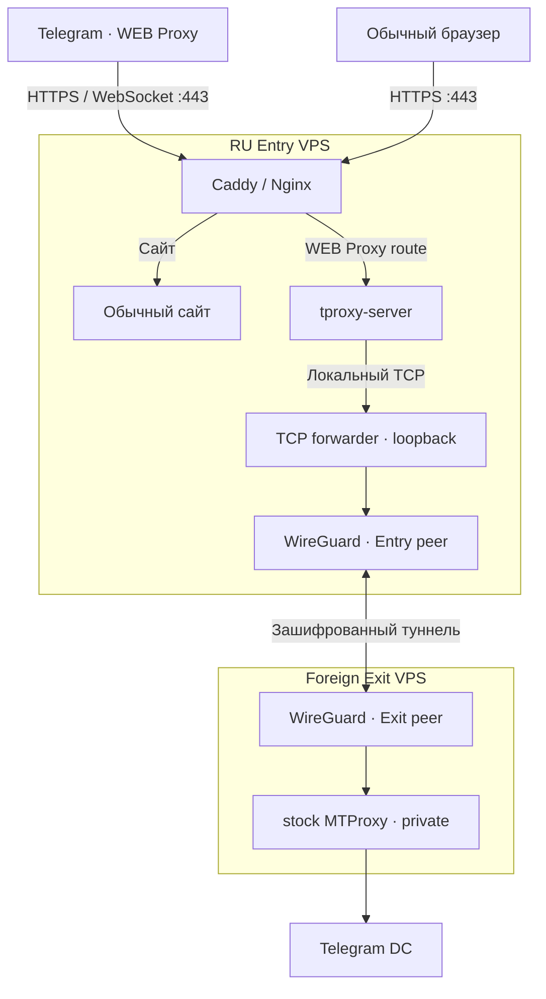

# TWebProxy Manager

Telegram WEB Proxy Manager for Debian/Ubuntu: HTTPS, обычный сайт и управляемый прокси на одном домене. **GitHub `main` — v0.2.25-beta. Этот пакет — неопубликованный кандидат v0.2.26-beta, не stable Release и не production.**

[Архитектура](#как-это-работает) · [Установка](#начало-работы) · [Команды](#управление) · [Bridge](docs/bridge-gate3/OPERATIONS.md) · [Статус](#статус-и-известные-риски)

В исходники входят `bridge/` и `sites/`; не устанавливайте один отдельно скачанный Bash-файл. Исправления P1 версии 0.2.24 прошли отдельную целевую проверку, а не полную RC-приёмку.

Интеграция v0.2.26 пока **не готова к merge/релизу**: реальный script-only
`manager-update` не переносит новый пакет Bridge. Локальный профиль сохраняется;
полный проверенный дистрибутив и штатный repair восстанавливают пакет. Это обход,
а не исправление updater. См. [PRERC-UPDATE-01](docs/PRERC-v0.2.26.md).

## Зачем нужен

TWebProxy использует официальный `tproxy-server` и stock MTProxy, Caddy/Nginx, systemd и nftables. Это **Telegram WEB Proxy**, не VPN общего назначения и не VLESS/Xray.

Два режима: **локальный** (один VPS с MTProxy) и **Bridge** (RU Entry принимает HTTPS, Foreign Exit выполняет MTProxy через WireGuard). Пользователь подключается только к RU-домену. Стандартный сайт — встроенные **«Культурные маршруты Подмосковья»** из `sites/podmoskovye/`. Пользовательские статические сайты и локальные приложения поддерживаются.

## Как это работает

### Bridge: RU Entry → Foreign Exit



Клиент получает **одну секретную ссылку на RU-домен**. Зарубежная нода не является вторым публичным endpoint. Менеджер устанавливает и обслуживает Bridge через проверенный SSH. Для присоединённого инстанса локальный MTProxy выключается после безопасного переключения, остальные инстансы остаются локальными.

### Один VPS — обычный режим

```text
Telegram WEB client ──HTTPS/WSS :443──> Caddy/Nginx
                                       ├── / → сайт
                                       └── WEB route → tproxy-server
                                                        → stock MTProxy (локально)
                                                        → Telegram DC
```

В односерверном режиме нет WireGuard и зарубежного VPS. Подробности: [ARCHITECTURE.md](docs/ARCHITECTURE.md).

## Начало работы

Базовые требования: Debian 12+ / Ubuntu 22.04+, x86_64, systemd, root, публичный IPv4, DNS `A`, TCP 443 и обычно TCP 80 для ACME. **Bridge реально проверялся только** на Ubuntu 26.04 x86_64 (RU Entry) и Ubuntu 24.04 x86_64 (Exit).

Для этого неопубликованного кандидата используйте полную `source/` из проверенного
архива, а не клонирование более старого `main`. На отдельно разрешённой тестовой VM:

```bash
cd /path/to/extracted/source
sha256sum -c SHA256SUMS
sudo bash ./twebproxy-manager.sh menu
```

Быстрая настройка: язык, домен, проверка DNS/среды/портов, стандартный сайт и
совместимый HTTPS, план и явное согласие. Имя профиля, secret и внутренние порты
генерируются автоматически. Неизвестный listener или неподтверждённый DNS
останавливают Quick; расширенный режим сохраняет ручные настройки.
[Описание TUI](docs/TUI-SMART-DEFAULTS.md) · [Инвентаризация ввода](TUI-INPUT-INVENTORY.md).

Для Bridge откройте «Зарубежные узлы / Мост → Добавить зарубежный узел», укажите
адрес и SSH-доступ, **независимо проверьте ED25519 host key**, затем подтвердите
план. При active/pending состоянии доступны статус/диагностика/repair/remove;
повторное добавление не перезаписывает узел и не закрывает Manager.
В MVP — одна зарубежная нода и один профиль Bridge-инстанса.

## Управление

```bash
sudo twebproxy                                # Меню
sudo twebproxy add                            # Создать инстанс
sudo twebproxy list                           # Список
sudo twebproxy status HOST                    # Статус
sudo twebproxy diagnose HOST                  # Диагностика
sudo twebproxy audit HOST                     # Проверка изоляции
sudo twebproxy repair HOST                    # Ремонт
sudo twebproxy show HOST                      # Профили (возможен вывод secrets)
sudo twebproxy connection-link HOST default   # Одна tg://webproxy ссылка (secret)
sudo twebproxy foreign-node add               # Автоматически добавить Exit
sudo twebproxy foreign-node status            # Статус Bridge
sudo twebproxy foreign-node diagnose          # Диагностика Bridge
sudo twebproxy foreign-node repair            # Восстановление Bridge
sudo twebproxy foreign-node remove            # Удаление / возврат локального MTProxy
sudo twebproxy dpi list-methods               # Режимы сети
```

Обновления Manager и операции изменения профилей ограничены, пока Bridge подключён. [Инструкции Gate 3](docs/bridge-gate3/OPERATIONS.md).

## Совместимость сети / Anti-DPI

**По умолчанию — STOCK.** Менеджер не должен без необходимости изменять сетевой трафик. Остальные режимы — расширенные экспериментальные настройки; ни один не гарантирует доступность в любой сети.

| Режим | Назначение |
| :--- | :--- |
| `stock` | Без вмешательства в TCP; рекомендуемый baseline |
| `window1152` | Объявляет уменьшенное TCP-окно в SYN+ACK |
| `mss88` | Объявляет MSS 88; возможны высокие накладные расходы |
| `nfqws` | Обработка первых ответных пакетов через pinned nfqws |
| `window1152_nfqws` | Комбинация двух механизмов |
| `mss88_nfqws` | Более агрессивная комбинация |

> [!CAUTION]
> Режимы относятся к **IPv4 TCP/443 на публичном IP сервера**, а не только к одному Telegram hostname. На общем IP они могут затронуть другие HTTPS-службы. Поэтому включение требует явного `--accept-shared-scope`. При проблемах сначала проверьте DNS, сертификат, маршрут и доступность backend — не включайте все режимы подряд.

## FAQ — частые вопросы и ошибки

<details>
<summary><strong>При обновлении: «SHA256SUMS не содержит корректный hash для twebproxy-manager.sh»</strong></summary>

Это сообщение может появиться в старом updater **v0.2.9** при загрузке кода из GitHub. Он ищет в контрольном файле имя **строго** `twebproxy-manager.sh` и не распознаёт `./twebproxy-manager.sh`.

В первой публикации v0.2.22 путь в `SHA256SUMS` был записан с `./`; формат исправлен в [коммите 409da88](https://github.com/Lazarev33/twebproxy-manager/commit/409da88bed135b9f27ae069e0fd000d97b507b9e).

Проверка без установки:

```bash
curl -fsSL https://raw.githubusercontent.com/Lazarev33/twebproxy-manager/main/SHA256SUMS \
  | grep 'twebproxy-manager.sh'
```

Должна быть одна строка с 64-символьным SHA-256 и именем **без** `./`. Если CDN ещё возвращает старый файл, проверьте его снова позднее; не отключайте проверку хеша. Другая ошибка, `SHA-256 manager candidate не совпал с SHA256SUMS`, означает именно несоответствие содержимого — не устанавливайте такой файл.

> Примечание: v0.2.25-beta в `main` — **не стабильный подписанный релиз**. Корректная контрольная сумма сама по себе не делает эту версию безопасной для production.

</details>

<details>
<summary><strong>«Не удалось создать и проверить локальную резервную копию перед обновлением»</strong></summary>

Перед заменой менеджера создаётся проверенный **локальный backup**. Если он не создан, обновление прерывается **до замены исполняемых файлов**.

**Известный конфликт при переходе с v0.2.9:** старый updater требует от `/var/lib/twebproxy` права ровно `0700 root:root`. Но у Nginx/Certbot этот же каталог может служить родителем ACME webroot `/var/lib/twebproxy/acme`, которому веб-серверу нужен доступ. При `0755` старый updater не создаёт backup.

Диагностика (команды ничего не меняют):

```bash
for p in /var/lib/twebproxy /var/lib/twebproxy/update-backups \
  /usr/local/sbin/twebproxy \
  /opt/twebproxy-manager/twebproxy-manager.sh; do
  if [ -e "$p" ]; then stat -c '%a %U:%G %n' "$p"; else echo "MISSING: $p"; fi
done

sha256sum /usr/local/sbin/twebproxy \
  /opt/twebproxy-manager/twebproxy-manager.sh

grep -RnF '/var/lib/twebproxy' \
  /etc/nginx/sites-enabled /etc/nginx/conf.d \
  /etc/letsencrypt/renewal 2>/dev/null
```

Одинаковые SHA-256 у обеих копий — ожидаемое безопасное состояние. Отсутствие `update-backups` до первого успешного backup само по себе не ошибка: папка должна создаваться менеджером.

**Решение зависит от использования каталога:**

- **Если ACME использует `/var/lib/twebproxy/acme`:** не запускайте вслепую `chmod 700 /var/lib/twebproxy` — это может нарушить HTTP-01 и продление сертификата. На действующем сервере сохраните рабочую конфигурацию и отложите переход на beta. При необходимости миграции сначала испытайте перенос webroot на отдельном тестовом сервере, перенастройте и проверьте Nginx и Certbot (`nginx -t`, `certbot renew --dry-run`), и только затем меняйте права старого каталога.
- **Если ACME и другие службы не используют этот каталог:** проверьте его назначение, владельца и содержимое. Для старого updater необходим `0700 root:root`, а сама `update-backups` должна быть приватной `0700`. Меняйте права только после подтверждения отсутствия зависимых сервисов.
- **В v0.2.22** проверка исправлена: корневому каталогу разрешены безопасные права вроде `0755 root:root` (без записи для группы/остальных), а `update-backups` по-прежнему требует `0700`. Но это **не исправляет автоматически** несовместимый updater, уже установленный в v0.2.9.

Не удаляйте backup и не обходите его проверку ради обновления. При продолжении ошибки проверьте свободное место и журнал менеджера, не публикуя секреты.

</details>

<details>
<summary><strong>Обновление не удалось — можно ли продолжать пользоваться прокси?</strong></summary>

При сообщениях о неудачной проверке SHA-256 или невозможности создать backup менеджер отказывается менять исполняемые файлы. Проверьте версию установленного менеджера и состояние служб:

```bash
/usr/local/sbin/twebproxy --help | head -n 3
sha256sum /usr/local/sbin/twebproxy \
  /opt/twebproxy-manager/twebproxy-manager.sh
```

Эти команды не подтверждают работоспособность всей цепочки: отдельно проверьте HTTPS, состояние инстанса и firewall. Если обновление успело начаться и завершилось другой ошибкой, не предполагайте, что обе копии автоматически вернулись к прежнему состоянию — используйте документированный порядок восстановления из [UPDATES.md](docs/UPDATES.md).

</details>

<details>
<summary><strong>Почему `main` показывает новую версию, а автоматическое обновление не работает?</strong></summary>

`main` — ветка разработки, а не GitHub Release. Начиная с Stage F, новый updater принимает только подходящий опубликованный стабильный Release и требует доверенную подпись либо независимо полученный оператором SHA-256. Старый v0.2.9 использует другой механизм проверки `SHA256SUMS`. Эти два механизма не следует смешивать.

На данный момент **v0.2.25-beta опубликована как код для разработки**, а не как безопасный автоматический production-update. Подробности — [UPDATES.md](docs/UPDATES.md).

</details>

Проверки коррекции v0.2.26 выполняются только в изолированных файловых/процессных
fixtures. Новые публичные DNS/TLS, два VPS и Telegram-приложение для этого
кандидата — NOT_EXECUTED. Результаты прежнего Gate3 не переименовываются в новые.
См. отчёт текущего пакета и [тесты](tests/tui-smart-defaults/README.md).

## Статус и известные риски

| Этап | Состояние |
| --- | --- |
| Stage H / v0.2.22 | Исторический принятый UX checkpoint |
| v0.2.23 | Отклонён: два воспроизведённых P1 |
| v0.2.24 | Оба P1 исправлены, целевая приёмка пройдена; ещё не RC |
| Gate 1 | CONDITIONAL GO: два VPS, WireGuard, MTProxy, server-side protocol |
| Gate 2 | CONDITIONAL ACCEPTANCE: 17 PASS / 0 FAIL / 8 NOT_EXECUTED |
| v0.2.25 / Gate 3 | Источники опубликованы в `main`, HTTPS/сайт/Bridge испытаны на тестовых VPS |
| Bridge TUI correction | Повторное добавление ноды не должно закрывать всё меню; локальные регрессии PASS, развёртывание коррекции на RU Entry не подтверждено |
| Smart Defaults / v0.2.26-beta | Неопубликованный кандидат: автоматические значения/пресеты, точечная коррекция подтверждений, локализации и ERR; без развёртывания |
| Stable Release / полный RC | Не выпущен |

Оператор сообщил об успешной работе **Telegram для iOS 13.1.2** через RU-домен: сообщения, фото, видеосообщения, крупный файл, восстановление после потери сети и Wi-Fi/LTE. Серверные счётчики подтверждают активность, но не было независимой проверки содержимого файла по хешу. **Telegram Desktop и другие клиенты — NOT_EXECUTED** в этом испытании. Подробности — [CLIENT-VALIDATION.md](docs/bridge-gate3/CLIENT-VALIDATION.md).

Холодная перезагрузка двух серверов, более широкая совместимость, безопасность и полная приёмка RC остаются открытыми. Ни работа сайта, ни эти тесты не гарантируют обход DPI.

## Документация

| Документ | Для чего |
| :--- | :--- |
| [Architecture](docs/ARCHITECTURE.md) | Локальная и двухсерверная схемы, процессы и границы доверия |
| [Bridge Gate 3](docs/bridge-gate3/OPERATIONS.md) | Установка, управление и диагностика ноды |
| [Client validation](docs/bridge-gate3/CLIENT-VALIDATION.md) | Реальная проверка Telegram и её ограничения |
| [Default website](docs/bridge-gate3/DEFAULT-SITE.md) | Встроенный сайт и сохранение правок |
| [Roadmap](docs/ROADMAP.md) | Этапы, статус и условия RC |
| [Security](docs/SECURITY.md) | Секреты, права и границы безопасности |
| [Testing](docs/TESTING.md) | Лабораторные наборы и пределы тестового покрытия |
| [Updates](docs/UPDATES.md) | Проверка обновлений, backup и rollback |
| [Upstream](docs/UPSTREAM.md) | Исходные компоненты и их происхождение |

---

<details>
<summary><strong>English — short overview</strong></summary>

GitHub main contains **v0.2.25-beta**; this package is the unpublished **v0.2.26-beta** TUI candidate. Both are development checkpoints. It supports single-VPS local MTProxy and managed **RU Entry → WireGuard → Foreign Exit** mode with one RU-facing Telegram WEB Proxy link. A static default website ships with the source. Gate 3 includes operator-reported iOS tests but not full platform/client/RC acceptance. GitHub main is not a stable Release.

</details>

<div align="center">

**Open source · Self-hosted · Development beta**

Built around official Telegram components. No claims of invisible traffic, unblockable IPs, or guaranteed DPI circumvention.

</div>
