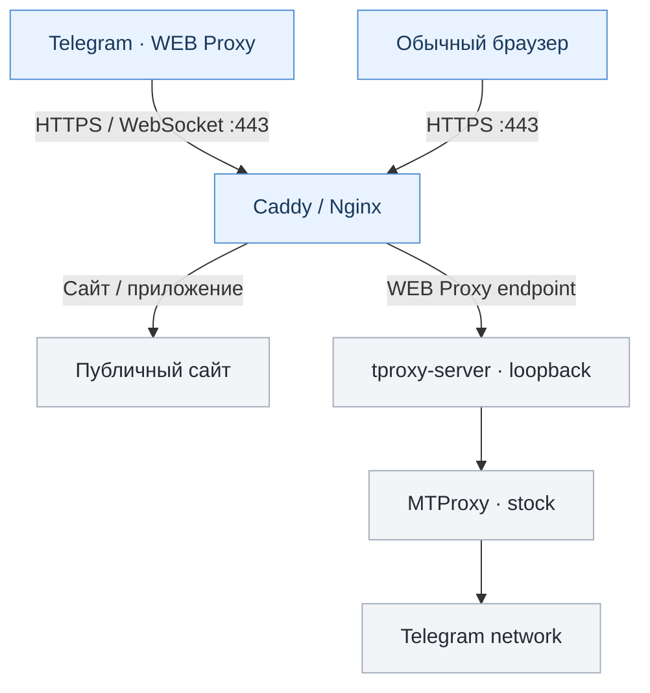

<div align="center">

# TWebProxy Manager

**Telegram WEB Proxy на своём сервере. Настоящий HTTPS, понятное управление.**

Самостоятельное размещение · Несколько доменов и профилей · Caddy / Nginx · RU / EN


[Возможности](#возможности) · [Как работает](#как-это-работает) · [Начало работы](#начало-работы) · [Команды](#управление) · [FAQ](#faq--частые-вопросы-и-ошибки) · [Статус разработки](#статус-и-известные-риски)

</div>

---

> [!WARNING]
> **Пока не production-ready.** Последний проверенный checkpoint — **v0.2.22-beta (Stage H)**. В `main` теперь опубликован **v0.2.22-beta (Stage H)**. Публикация исходников не означает исправления подтверждённых P1 и не является production-релизом. Предрелизные испытания выявили открытые P1, включая потерю изоляции backend после отдельных операций с `nftables.service`. Не используйте эту версию как подтверждённый безопасный production-релиз.

## Зачем нужен TWebProxy

TWebProxy Manager — Bash-менеджер для собственного **Telegram WEB Proxy** на Debian/Ubuntu. Он объединяет веб-фронтенд с обычным HTTPS, Telegram relay, штатный MTProxy, сертификаты, профили, firewall и диагностику.

**Это именно WEB Proxy**, а не VLESS/Xray, VPN-туннель или замена Telegram-клиента. Основа — [официальный tproxy-server](https://github.com/telegramdesktop/tproxy-server) и [stock MTProxy](https://github.com/TelegramMessenger/MTProxy).

### Возможности

| 🌐 HTTPS и сайт | 🔑 Пользователи и профили |
| :--- | :--- |
| Caddy или Nginx; Let's Encrypt или собственный сертификат; обычный сайт на том же hostname | Несколько инстансов, независимые профили и secret, ротация доступа |
| **🛡️ Изоляция и диагностика** | **🧰 Обслуживание** |
| nftables, проверка портов и служб, диагностика TLS, безопасные отчёты | Проверяемое обновление, локальный backup, откат, управление службами |

В **v0.2.22-beta** также реализованы пошаговый мастер настройки, первое включение RU/EN, короткие сводки, подсказки к ошибкам и помощь с Telegram-ссылками.

## Как это работает



Запросы к сайту обслуживаются как обычный HTTPS. WEB Proxy проходит через отдельный маршрут к relay и MTProxy. Backend не должен быть доступен напрямую из интернета — именно поэтому проверка firewall входит в обязательные предрелизные испытания.

## Начало работы

**Требования:** Debian 12+ / Ubuntu 22.04+, x86_64, systemd, root, публичный IPv4, доменное имя с правильной DNS `A`-записью. Для HTTPS нужен TCP 443, для автоматических сертификатов обычно также TCP 80.

Для **отдельной тестовой VM**:

```bash
git clone https://github.com/Lazarev33/twebproxy-manager.git
cd twebproxy-manager
chmod +x twebproxy-manager.sh
sudo ./twebproxy-manager.sh
```

> [!IMPORTANT]
> Эта команда получает опубликованный **v0.2.22-beta из `main`**. Это всё ещё тестовая версия с известными P1; проверяйте `VERSION`, Git-коммит и результаты тестов до установки. Не запускайте на production VPS.

### Рекомендуемый сценарий в v0.2.22-beta

```text
1. Выбрать язык → RU / EN
2. Быстрая настройка → hostname
3. Выбрать сайт → временная страница, static или local app
4. HTTPS → Caddy (рекомендуется)
5. Сетевой режим → STOCK
6. Проверить план → подтвердить
7. Получить Telegram WEB Proxy ссылки
```

Реальный сайт на том же hostname можно подключить из статического каталога или локального приложения. **Конструктора сайтов пока нет.**

## Управление

Основные команды для checkpoint v0.2.22 (после установки менеджера в систему):

```bash
sudo twebproxy                   # Интерактивное меню
sudo twebproxy add               # Создать инстанс
sudo twebproxy list              # Список инстансов
sudo twebproxy show HOST         # Ссылки для Telegram (содержат secret)
sudo twebproxy status HOST       # Краткое состояние
sudo twebproxy diagnose HOST     # Диагностика
sudo twebproxy audit HOST        # Проверка конфигурации и изоляции
sudo twebproxy repair HOST       # Восстановление конфигурации
sudo twebproxy cert-status HOST  # Проверка сертификата
sudo twebproxy profile-list HOST # Профили
sudo twebproxy dpi list-methods  # Сетевые режимы
```

Для машинного вывода есть `--json` и `--raw`; для отключения цветовых последовательностей — `--no-color`. Ссылки WEB Proxy и secret не публикуйте в логах, issue и скриншотах.

## Совместимость сети / Anti-DPI

**По умолчанию — STOCK.** Менеджер не должен без необходимости изменять сетевой трафик. Остальные режимы — расширенные экспериментальные настройки; ни один не гарантирует доступность в любой сети.

| Режим | Назначение |
| :--- | :--- |
| `stock` | Без вмешательства в TCP; рекомендуемый baseline |
| `window1152` | Объявляет уменьшенное TCP-окно в SYN+ACK |
| `mss88` | Объявляет MSS 88; возможны высокие накладные расходы |
| `nfqws` | Обработка первых ответных пакетов через pinned nfqws |
| `window1152_nfqws` | Комбинация двух механизмов |
| `mss88_nfqws` | Более агрессивная комбинация |

> [!CAUTION]
> Режимы относятся к **IPv4 TCP/443 на публичном IP сервера**, а не только к одному Telegram hostname. На общем IP они могут затронуть другие HTTPS-службы. Поэтому включение требует явного `--accept-shared-scope`. При проблемах сначала проверьте DNS, сертификат, маршрут и доступность backend — не включайте все режимы подряд.

## FAQ — частые вопросы и ошибки

<details>
<summary><strong>При обновлении: «SHA256SUMS не содержит корректный hash для twebproxy-manager.sh»</strong></summary>

Это сообщение может появиться в старом updater **v0.2.9** при загрузке кода из GitHub. Он ищет в контрольном файле имя **строго** `twebproxy-manager.sh` и не распознаёт `./twebproxy-manager.sh`.

В первой публикации v0.2.22 путь в `SHA256SUMS` был записан с `./`; формат исправлен в [коммите 409da88](https://github.com/Lazarev33/twebproxy-manager/commit/409da88bed135b9f27ae069e0fd000d97b507b9e).

Проверка без установки:

```bash
curl -fsSL https://raw.githubusercontent.com/Lazarev33/twebproxy-manager/main/SHA256SUMS \
  | grep 'twebproxy-manager.sh'
```

Должна быть одна строка с 64-символьным SHA-256 и именем **без** `./`. Если CDN ещё возвращает старый файл, проверьте его снова позднее; не отключайте проверку хеша. Другая ошибка, `SHA-256 manager candidate не совпал с SHA256SUMS`, означает именно несоответствие содержимого — не устанавливайте такой файл.

> Примечание: v0.2.22-beta в `main` — **не стабильный подписанный релиз**. Корректная контрольная сумма сама по себе не делает эту версию безопасной для production.

</details>

<details>
<summary><strong>«Не удалось создать и проверить локальную резервную копию перед обновлением»</strong></summary>

Перед заменой менеджера создаётся проверенный **локальный backup**. Если он не создан, обновление прерывается **до замены исполняемых файлов**.

**Известный конфликт при переходе с v0.2.9:** старый updater требует от `/var/lib/twebproxy` права ровно `0700 root:root`. Но у Nginx/Certbot этот же каталог может служить родителем ACME webroot `/var/lib/twebproxy/acme`, которому веб-серверу нужен доступ. При `0755` старый updater не создаёт backup.

Диагностика (команды ничего не меняют):

```bash
for p in /var/lib/twebproxy /var/lib/twebproxy/update-backups \
  /usr/local/sbin/twebproxy \
  /opt/twebproxy-manager/twebproxy-manager.sh; do
  if [ -e "$p" ]; then stat -c '%a %U:%G %n' "$p"; else echo "MISSING: $p"; fi
done

sha256sum /usr/local/sbin/twebproxy \
  /opt/twebproxy-manager/twebproxy-manager.sh

grep -RnF '/var/lib/twebproxy' \
  /etc/nginx/sites-enabled /etc/nginx/conf.d \
  /etc/letsencrypt/renewal 2>/dev/null
```

Одинаковые SHA-256 у обеих копий — ожидаемое безопасное состояние. Отсутствие `update-backups` до первого успешного backup само по себе не ошибка: папка должна создаваться менеджером.

**Решение зависит от использования каталога:**

- **Если ACME использует `/var/lib/twebproxy/acme`:** не запускайте вслепую `chmod 700 /var/lib/twebproxy` — это может нарушить HTTP-01 и продление сертификата. На действующем сервере сохраните рабочую конфигурацию и отложите переход на beta. При необходимости миграции сначала испытайте перенос webroot на отдельном тестовом сервере, перенастройте и проверьте Nginx и Certbot (`nginx -t`, `certbot renew --dry-run`), и только затем меняйте права старого каталога.
- **Если ACME и другие службы не используют этот каталог:** проверьте его назначение, владельца и содержимое. Для старого updater необходим `0700 root:root`, а сама `update-backups` должна быть приватной `0700`. Меняйте права только после подтверждения отсутствия зависимых сервисов.
- **В v0.2.22** проверка исправлена: корневому каталогу разрешены безопасные права вроде `0755 root:root` (без записи для группы/остальных), а `update-backups` по-прежнему требует `0700`. Но это **не исправляет автоматически** несовместимый updater, уже установленный в v0.2.9.

Не удаляйте backup и не обходите его проверку ради обновления. При продолжении ошибки проверьте свободное место и журнал менеджера, не публикуя секреты.

</details>

<details>
<summary><strong>Обновление не удалось — можно ли продолжать пользоваться прокси?</strong></summary>

При сообщениях о неудачной проверке SHA-256 или невозможности создать backup менеджер отказывается менять исполняемые файлы. Проверьте версию установленного менеджера и состояние служб:

```bash
/usr/local/sbin/twebproxy --help | head -n 3
sha256sum /usr/local/sbin/twebproxy \
  /opt/twebproxy-manager/twebproxy-manager.sh
```

Эти команды не подтверждают работоспособность всей цепочки: отдельно проверьте HTTPS, состояние инстанса и firewall. Если обновление успело начаться и завершилось другой ошибкой, не предполагайте, что обе копии автоматически вернулись к прежнему состоянию — используйте документированный порядок восстановления из [UPDATES.md](docs/UPDATES.md).

</details>

<details>
<summary><strong>Почему `main` показывает новую версию, а автоматическое обновление не работает?</strong></summary>

`main` — ветка разработки, а не GitHub Release. Начиная с Stage F, новый updater принимает только подходящий опубликованный стабильный Release и требует доверенную подпись либо независимо полученный оператором SHA-256. Старый v0.2.9 использует другой механизм проверки `SHA256SUMS`. Эти два механизма не следует смешивать.

На данный момент **v0.2.22-beta опубликована как код для разработки**, а не как безопасный автоматический production-update. Подробности — [UPDATES.md](docs/UPDATES.md).

</details>

## Статус и известные риски

| Этап | Состояние |
| :--- | :--- |
| Stage A–H | Разработка завершена; Stage H независимо проверен как development checkpoint |
| Linux-интеграция | Проверялись реальные обновления, откаты, systemd, nftables, Nginx и Caddy/ACME |
| Предрелизная готовность | **BLOCKED** — подтверждённые дефекты ещё не исправлены |
| Production release | **Не опубликован** |

**Открытые проблемы перед RC:**

1. **Firewall / P1:** операции с `nftables.service` могут удалять правила изоляции backend или останавливать обе ноды.
2. **Rollback / P1:** при отказе записи `global.env` возможно ложное сообщение об успешном восстановлении.
3. **Локальные секреты / P1:** stock MTProxy передаёт `-S` в аргументах процесса, видимых некоторым локальным пользователям.
4. **DPI / P2:** после ENOSPC сохранённое состояние и реальная таблица ядра могут расходиться.

Сценарии с реальными клиентами Telegram и подписанным GitHub-релизом также ещё требуют отдельной проверки. **Не воспринимайте успешные модельные тесты как доказательство production-ready.**

Полная история и план исправлений — в [ROADMAP](docs/ROADMAP.md).

## Документация

| Документ | Для чего |
| :--- | :--- |
| [Architecture](docs/ARCHITECTURE.md) | Компоненты, маршруты и разделение ответственности |
| [Roadmap](docs/ROADMAP.md) | Этапы, статус и условия RC |
| [Security](docs/SECURITY.md) | Секреты, права и границы безопасности |
| [Testing](docs/TESTING.md) | Лабораторные наборы и пределы тестового покрытия |
| [Updates](docs/UPDATES.md) | Проверка обновлений, backup и rollback |
| [Upstream](docs/UPSTREAM.md) | Исходные компоненты и их происхождение |

---

<details>
<summary><strong>English — short overview</strong></summary>

**TWebProxy Manager** is a self-hosted Telegram WEB Proxy manager for Debian/Ubuntu. It combines Caddy/Nginx HTTPS, a real public website, the official `tproxy-server`, stock MTProxy, multiple instances/profiles, nftables isolation, diagnostics and verified update workflows.

The latest independently checked development checkpoint is **v0.2.22-beta (Stage H)**. Its guided RU/EN setup recommends **Caddy + HTTPS + STOCK**. The `main` branch now contains the **v0.2.22-beta** development code. Known P1 defects block a production Release Candidate. **Do not deploy as production-ready software.**

See the roadmap and security documentation above before experimenting on a disposable VPS.

</details>

<div align="center">

**Open source · Self-hosted · Development beta**

Built around official Telegram components. No claims of invisible traffic, unblockable IPs, or guaranteed DPI circumvention.

</div>
